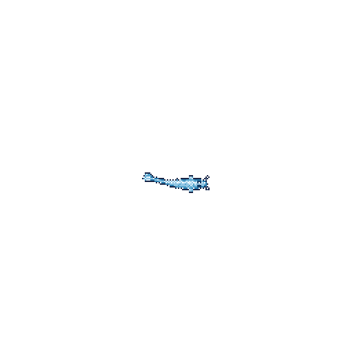

# Hi there 👋

This pixel-art koi is generated with [Git Koi](https://github.com/yalongwastaken/git-koi) from my public GitHub activity. Its size grows with my total contributions through the last complete UTC day; its colors reflect languages in public repositories I own or contribute to, its markings reflect contribution streaks, and its swim reflects recent activity.

  

